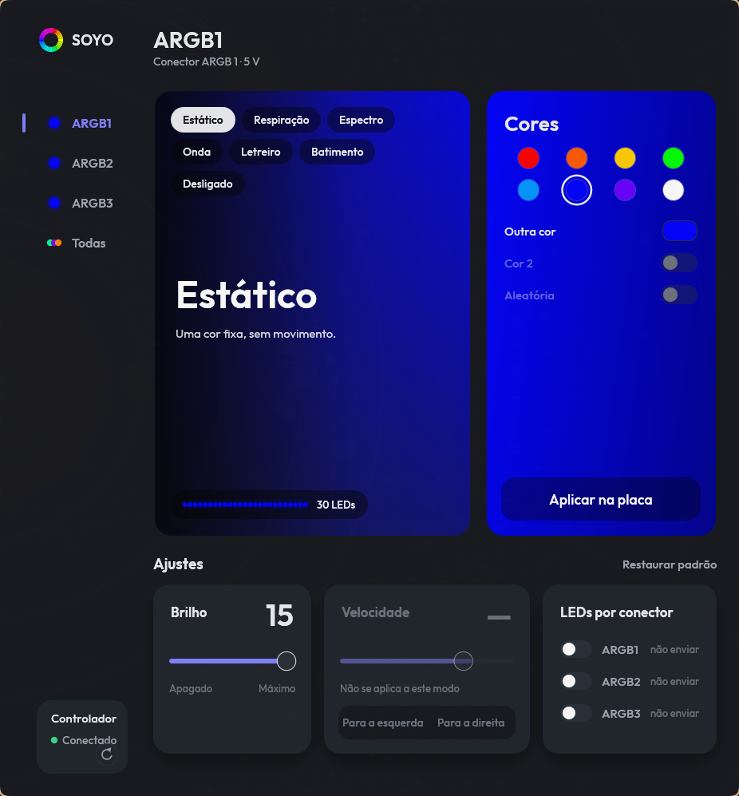

# soyo-argb

A simple Linux port of the LED control software for the SOYO B550M ARGB motherboard. SOYO only ships a
Windows app (`GamingLightControl`), and I couldn't find anything on Linux that controlled my LEDs properly,
so I reverse engineered the original app with [REA](https://www.npmjs.com/package/rea-agents) and rewrote the
part I needed in Rust. It was the best I could do, and it probably has bugs. If you find one and know how to
fix it, open a pull request.

It talks to the board's SONiX USB controller (`0c45:7125`) and supports modes, colors, brightness, speed,
direction, global control and LED count on the ARGB1, ARGB2 and ARGB3 headers (5 V, 3 pins). The 12 V RGB
headers, Music Rhythm and the temperature readout are not implemented. I only tested it on my own board, with
LEDs on ARGB3.



[Leia em português](#português)

## Install

You need a Rust toolchain (`cargo`).

```sh
cargo install --path . --features gui --root ~/.local
sudo install -m644 packaging/60-soyo-argb.rules /etc/udev/rules.d/
sudo udevadm control --reload
sudo udevadm trigger --action=change --subsystem-match=hidraw
install -Dm644 packaging/soyo-argb.service ~/.config/systemd/user/soyo-argb.service
systemctl --user enable --now soyo-argb
install -Dm644 packaging/soyo-argb.desktop ~/.local/share/applications/soyo-argb.desktop
```

The udev rule gives the logged-in user read and write access to the controller's `/dev/hidrawN`. The user
service reapplies your configuration at login, when the controller shows up again, and after resuming from
suspend.

## Usage

```sh
soyo-argb status
soyo-argb set --zone 3 --mode static --color ff0000 --brightness 15
soyo-argb set --zone 3 --mode breathing --color ff0000 --color2 00ff00 --speed 4
soyo-argb set --zone 3 --mode wave --direction right --speed 10
soyo-argb set --zone all --mode spectrum --speed 8      # global control: every zone
soyo-argb set --zone 1 --mode off
soyo-argb led-count --header 3 --count 40
soyo-argb recolor --color c2c6d5 --color2 d4c4ac          # new colors, same modes (see matugen below)
soyo-argb apply                                          # resend the whole configuration
soyo-argb restore                                        # default profile: static blue, brightness 15
soyo-argb-gui                                            # window; every change goes to the board by itself
```

In the window, switching zones only shows that zone's settings. Changing the mode, color, brightness, speed,
direction or LED count writes to the board 0.3 s after you stop changing it, so dragging a slider causes one
write instead of dozens.

Brightness and speed go from 0 to 15 (speed 15 is the fastest). Parameters per mode:

| Mode | `--color` | `--color2` | `--random` | `--speed` | `--brightness` | `--direction` |
|---|---|---|---|---|---|---|
| `static` | required | | | | ✓ | |
| `breathing`, `heartbeat` | required | ✓ | ✓ | ✓ | ✓ | |
| `spectrum` | | | | ✓ | ✓ | |
| `wave` | | | | ✓ | ✓ | ✓ |
| `marquee` | required | ✓ | | ✓ | ✓ | ✓ |
| `off` | | | | | | |

The configuration lives in `$XDG_CONFIG_HOME/soyo-argb/config.toml` (by default
`~/.config/soyo-argb/config.toml`):

```toml
# Without [global], each zone is written separately and global control is turned off.
[[zone]]
id = 3
mode = "breathing"
color = "#ff0000"
color2 = "#00ff00"
brightness = 15
speed = 4

[led_count]
header3 = 40
```

Every write goes to the controller's EEPROM, which keeps the effect even when nothing is running.

`soyo-argb raw <128 hex> [--read]` sends a raw Feature report. It is only for development and writes straight
to the device.

## Wallpaper colors (matugen)

`soyo-argb recolor --color <rrggbb> [--color2 <rrggbb>]` swaps the colors of the saved configuration and keeps
each zone's mode, brightness, speed and direction. `--color` goes to every zone whose mode has a color
(`static`, `breathing`, `heartbeat`, `marquee`); `--color2` only replaces a second color the zone already has.
`spectrum`, `wave`, `off` and random colors stay as they are. Only zones that change are written, so running it
again with the same palette does not touch the EEPROM.

To follow the wallpaper with [matugen](https://github.com/InioX/matugen), install the template and add it to
your matugen config:

```sh
install -Dm644 packaging/matugen/soyo-argb.txt ~/.config/soyo-argb/matugen-template.txt
```

```toml
[templates.soyo-argb]
input_path = "~/.config/soyo-argb/matugen-template.txt"
output_path = "~/.cache/soyo-argb/palette"
post_hook = "soyo-argb recolor --color {{colors.primary.dark.hex_stripped}} --color2 {{colors.tertiary.dark.hex_stripped}}"
```

On Ryoku, put the section in `~/.config/ryoku/palette-bridge/matugen.toml` (the shell runs it on every palette
change and Ryoku updates do not overwrite it) and use the Ryoku hook instead. The roles Ryoku hands to matugen
are muted (a bluish wallpaper gives `primary = #c2c6d5`, almost white on LEDs), so the script takes tone 60 of
the primary and tertiary tonal palettes in `~/.cache/ryoku/tones.json`, the strong accent tones:

```sh
install -Dm755 packaging/matugen/ryoku-recolor.sh ~/.config/soyo-argb/ryoku-recolor.sh
```

```toml
post_hook = "sh ~/.config/soyo-argb/ryoku-recolor.sh"
```

matugen runs hooks in your `$SHELL`, which may be fish, so anything beyond a single command belongs in a script.

## How it was made

I used REA with Ghidra on the original DLLs and recorded the USB traffic of the Windows app running under Wine
with `usbmon`. The protocol is written up in `docs/protocol.md`. `re/` has the hashes of the original binaries,
the notes from the analysis, the USB captures and the test fixtures; `cargo test` checks the encoder against the
reports captured from the original app. The original installer and the REA evidence bundles are not in this
repository because they belong to SOYO or contain decompiled SOYO code.

## Contributing

Bug reports and pull requests are welcome. If you have other LEDs (RGB 12 V headers, another board revision)
and can test them, that would help the most.

The interface uses the [Outfit](https://github.com/Outfitio/Outfit-Fonts) font (SIL OFL 1.1,
`assets/fonts/OFL.txt`), embedded in the binary. The code is under the MIT license (`LICENSE`).

## Português

Um port simples para Linux do software de LEDs da placa-mãe SOYO B550M ARGB. A SOYO só oferece um app para
Windows (`GamingLightControl`) e eu não encontrei nada no Linux que controlasse direito as minhas LEDs, então fiz
engenharia reversa do app original com o [REA](https://www.npmjs.com/package/rea-agents) e reescrevi em Rust a
parte de que eu precisava. Foi o melhor que deu para fazer, e provavelmente tem erros. Se você encontrar algum e
souber consertar, é só abrir um pull request.

Ele conversa com o controlador USB SONiX da placa (`0c45:7125`) e suporta modos, cores, brilho, velocidade,
direção, controle global e quantidade de LEDs nos conectores ARGB1, ARGB2 e ARGB3 (5 V, 3 pinos). Os conectores
RGB 12 V, o Music Rhythm e a leitura de temperaturas não estão implementados. Só testei na minha placa, com LEDs
no ARGB3.

### Instalação

Precisa do Rust (`cargo`).

```sh
cargo install --path . --features gui --root ~/.local
sudo install -m644 packaging/60-soyo-argb.rules /etc/udev/rules.d/
sudo udevadm control --reload
sudo udevadm trigger --action=change --subsystem-match=hidraw
install -Dm644 packaging/soyo-argb.service ~/.config/systemd/user/soyo-argb.service
systemctl --user enable --now soyo-argb
install -Dm644 packaging/soyo-argb.desktop ~/.local/share/applications/soyo-argb.desktop
```

A regra udev dá ao usuário logado acesso de leitura e escrita ao `/dev/hidrawN` do controlador. O serviço de
usuário reaplica a configuração no login, quando o controlador reaparece e ao voltar da suspensão.

### Uso

```sh
soyo-argb status
soyo-argb set --zone 3 --mode static --color ff0000 --brightness 15
soyo-argb set --zone 3 --mode breathing --color ff0000 --color2 00ff00 --speed 4
soyo-argb set --zone 3 --mode wave --direction right --speed 10
soyo-argb set --zone all --mode spectrum --speed 8      # controle global: todas as zonas
soyo-argb set --zone 1 --mode off
soyo-argb led-count --header 3 --count 40
soyo-argb recolor --color c2c6d5 --color2 d4c4ac          # cores novas, mesmos modos (veja matugen abaixo)
soyo-argb apply                                          # reenvia a configuração inteira
soyo-argb restore                                        # perfil padrão: estático azul, brilho 15
soyo-argb-gui                                            # janela; cada mudança vai para a placa sozinha
```

Na janela, trocar de zona só mostra a configuração dela. Mudar modo, cor, brilho, velocidade, direção ou
quantidade de LEDs grava na placa 0,3 s depois que você para de mexer, então arrastar um slider gera uma gravação
e não dezenas.

Brilho e velocidade vão de 0 a 15 (velocidade 15 é a mais rápida). A tabela de parâmetros por modo e o exemplo
de `config.toml` estão na seção em inglês acima; o arquivo fica em `$XDG_CONFIG_HOME/soyo-argb/config.toml`
(padrão `~/.config/soyo-argb/config.toml`).

Cada gravação vai para a EEPROM do controlador, que mantém o efeito mesmo sem nada rodando.

`soyo-argb raw <128 hex> [--read]` envia um Feature report cru. Serve só para desenvolvimento e grava direto no
dispositivo.

### Cores do wallpaper (matugen)

`soyo-argb recolor --color <rrggbb> [--color2 <rrggbb>]` troca as cores da configuração salva e mantém modo,
brilho, velocidade e direção de cada zona. `--color` vai para toda zona cujo modo tem cor (`static`,
`breathing`, `heartbeat`, `marquee`); `--color2` só substitui uma segunda cor que a zona já tenha. `spectrum`,
`wave`, `off` e cor aleatória ficam como estão. Só as zonas que mudam são gravadas, então repetir a mesma paleta
não mexe na EEPROM.

Para seguir o wallpaper com o [matugen](https://github.com/InioX/matugen), instale o template
(`install -Dm644 packaging/matugen/soyo-argb.txt ~/.config/soyo-argb/matugen-template.txt`) e adicione a seção
`[templates.soyo-argb]` da parte em inglês à configuração do matugen. No Ryoku, coloque a seção em
`~/.config/ryoku/palette-bridge/matugen.toml` (o shell roda ela a cada troca de paleta e as atualizações do Ryoku
não sobrescrevem o arquivo) e use o hook do Ryoku: os papéis que o Ryoku passa ao matugen vêm esmaecidos (um
wallpaper azulado dá `primary = #c2c6d5`, quase branco nos LEDs), então o script
`packaging/matugen/ryoku-recolor.sh` (instalado em `~/.config/soyo-argb/ryoku-recolor.sh`, com
`post_hook = "sh ~/.config/soyo-argb/ryoku-recolor.sh"`) usa o tom 60 das paletas tonais primária e terciária de
`~/.cache/ryoku/tones.json`, os tons fortes de destaque. O matugen roda o hook no `$SHELL`, que pode ser fish;
por isso qualquer coisa além de um comando simples vai num script.

### Como foi feito

Usei o REA com o Ghidra nas DLLs originais e gravei o tráfego USB do app do Windows rodando no Wine com o
`usbmon`. O protocolo está descrito em `docs/protocol.md`. Em `re/` ficam os hashes dos binários originais, as
notas da análise, as capturas USB e as fixtures de teste; o `cargo test` compara a codificação com os relatórios
capturados do app original. O instalador original e os bundles de evidência do REA não estão no repositório
porque são da SOYO ou contêm código decompilado dela.

### Contribuindo

Relatos de bug e pull requests são bem-vindos. Quem tiver outras LEDs (conectores RGB 12 V, outra revisão da
placa) e puder testar ajuda muito.

A interface usa a fonte [Outfit](https://github.com/Outfitio/Outfit-Fonts) (SIL OFL 1.1, `assets/fonts/OFL.txt`),
embutida no binário. O código está sob a licença MIT (`LICENSE`).
