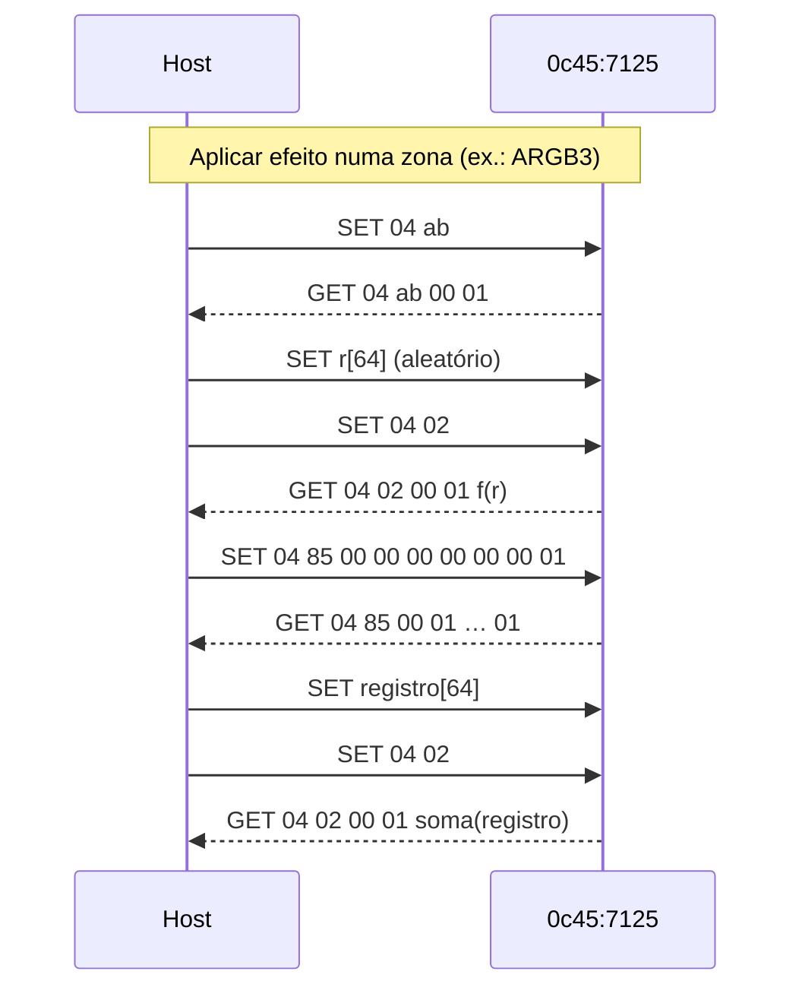
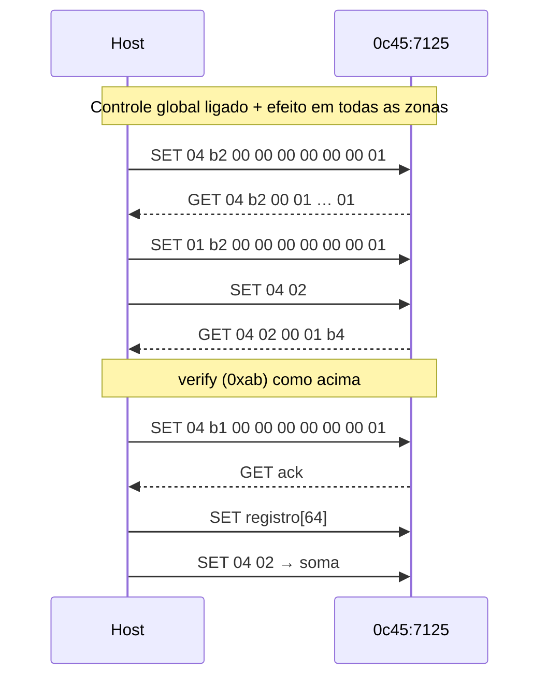
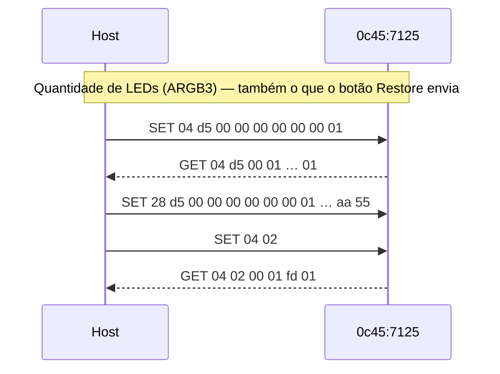

# Protocolo do controlador ARGB SONiX 0c45:7125 (SOYO B550M ARGB)

Especificação derivada da engenharia reversa do `GamingLightControl` V1.00.019 (SOYO/梅捷) e de capturas USB
do app rodando no Wine 11.20. Binários e hashes: `re/README.md`. Detalhes da análise estática: `re/findings.md`.
Capturas: `re/captures/*.pcapng` + `re/captures/SCENARIOS.md`. Fixtures: `re/fixtures/*.txt`.

Evidências: bundles REA em `re/evidence/`. Eles contêm código decompilado das DLLs da SOYO e por isso não estão
no repositório público; os Evidence IDs citados ficam como referência para quem refizer a análise.

| Bundle | Conteúdo |
|---|---|
| `static-sonixhiddll.json` | exports de transporte (`ev_6a919f0e…`) |
| `static-writer.json` | montagem de comandos (IDs citados abaixo) |
| `static-main.json`, `static-safeclose.json` | UI e SafeClose |
| `dynamic-bundle.json` | `inspect_packet_capture` de cada captura (IDs na tabela de capturas) |

Nada do que está marcado **só estático** foi implementado.

## 1. Transporte

O dispositivo expõe uma única coleção HID (Usage Page Consumer, sem Report ID) com relatórios Input, Output e
Feature de 64 bytes. **Todo o controle de iluminação usa Feature reports** (ep0):

| Operação no app | API Windows | USB | Linux (hidraw) |
|---|---|---|---|
| `HIDReportOut` | `HidD_SetFeature`, 65 B (`[0x00] + 64`) | SET_REPORT (bRequest 9), wValue `0x0300` | `HIDIOCSFEATURE(65)` com `[0x00] + 64 B` |
| `HIDReportIn` | `HidD_GetFeature`, 65 B | GET_REPORT (bRequest 1), wValue `0x0300` | `HIDIOCGFEATURE(65)` com buffer `[0x00] + 64 B` |
| `HIDReportOut2` | `WriteFile` | interrupt OUT 0x02 | só Music Rhythm (fora do escopo) |
| `HIDReportIn3` | `ReadFile` | interrupt IN 0x81 | temperaturas (fora do escopo) |

Evidência: estático `ev_6a919f0e…` (`HIDReportOut` → `HidD_SetFeature`); dinâmico: todas as escritas aparecem como
SET_REPORT `wValue=0x0300` em `01-startup.pcapng` (`ev_d2f50d62…`).

## 2. Primitivas

Notação: `[a b c …]` = os primeiros bytes de um Feature report de 64 bytes; o resto é zero.

### 2.1 Comando com ack (`cmd`)

1. SET `[04 op p2 00 00 00 00 00 p8]`
2. espera `CommandDelayTime` = 10 ms
3. GET → resposta `[04 op p2 01 …]`. **Ack = `resp[3] == 0x01`.** O app repete os passos 1–3 até 5 vezes.

Estático: `ev_b28b149c…` (assembly 0x10003489–0x100034a2), `ev_2568ae03…`. Dinâmico: todas as capturas
(ex.: `01-startup` `SET 04 05 … 02` → `GET 04 05 00 01 … 02`).

### 2.2 Soma de verificação (`sum`, opcode `0x02`)

`cmd(0x02)`; a resposta traz `u32 LE` em `resp[4..8]`. Depois de uma escrita, o valor é a **soma de todos os bytes**
do bloco de 64 B enviado. Ex.: registro `04 ff … 69 26 00 00 aa 55` → `0x0291` (`22-global-on-static-red`).
Depois de uma leitura, é a soma dos bytes lidos.

### 2.3 Verificação do dispositivo (`verify`, opcode `0xab`)

Executada pelo app antes de **toda** escrita de registro de iluminação:

1. `cmd(0xab)`
2. espera 10 ms; SET com 64 bytes aleatórios `r` (sem cabeçalho, sem GET)
3. espera 10 ms; `sum` → o dispositivo devolve `f(r)`:

```
f(r) = ( ((r[0x0c] + r[0x03]) & 0xff) << 24
       | ((r[0x3f] * 8)       & 0xff) << 16
       | ((r[0x06] - r[0x0d]) & 0xff) << 8
       |  (r[0x24] & 0xa5) ) ^ 0x54711688
```

O app só prossegue se o valor bater (verificação anti-clone do host). Estático: `ev_b28b149c…` (0x1000339f–0x100033ea).
Dinâmico: 6 pares `r`/resposta conferidos em `re/fixtures/verify-challenge.txt`.

### 2.4 Escrita de bloco (`write`)

1. `cmd(op, p8 = 0x01)` — `p8` é o número de blocos de 64 B (sempre 1 aqui)
2. espera 10 ms; SET com o bloco de 64 B
3. espera 10 ms; `sum` deve ser igual à soma dos bytes do bloco

Estático: `FUN_10006140` (`ev_ed2b1eff…`), `FUN_10006930` (`ev_2568ae03…`). Dinâmico: ver §4.

### 2.5 Leitura de bloco (`read`)

1. `cmd(op, p8 = n)`
2. `n` GETs de 64 B com os dados
3. `sum` (soma dos bytes lidos)

Dinâmico: `0x80/0x82/0x84`, `0xd2/0xd4/0xd6`, `0xb3` com `n=1`; `0x05` com `n=2` (`01-startup`, `06-group-select-g2-g3`).

## 3. Sequências







- **Abertura:** o app lê informações (`0x05`), envia `0x18`, `0xc1`, lê o controle global (`0xb3`), o registro e a
  contagem de LEDs do grupo selecionado, envia `04 f1 07` e `0x19` (`01-startup`). Nenhum desses passos precede as
  escritas feitas ao mexer nos controles, então **não há sequência de init obrigatória** para escrever.
- **Fechamento:** pelo X o app envia `0x18` e `0x19` (`25-close`); via `SafeClose.exe` só `0x18` (`26-safeclose`).
  Os LEDs não mudam. **Não há exit obrigatório.**
- **Restore:** reenvia a contagem de LEDs do grupo atual e o registro atual (`24-restore-and-static-red-g3`).
  Não existe comando de "padrão de fábrica".

## 4. Tabela de comandos usados pelo `soyo-argb`

| Opcode | Primitiva | Layout | Estático | Dinâmico (captura → Evidence) |
|---|---|---|---|---|
| `0x02` | `sum` | `04 02` | `ev_7be84500…` | todas |
| `0x05` | `read`, n=2 | `04 05 00 00 00 00 00 00 02` → 128 B (bytes 4..8 = `45 0c 25 71`: VID/PID LE) | `ev_7be84500…` | `01-startup` → `ev_d2f50d62…` |
| `0xab` | `verify` | §2.3 | `ev_b28b149c…` | `22-global-on-static-red` → `ev_e783c955…` |
| `0x81` `0x83` `0x85` | `write` registro ARGB1/2/3 | `04 op 00 00 00 00 00 00 01` + registro | `ev_ed2b1eff…`, tabela `ev_0a9f05a4…` | `23b-…` (`0x81`) → `ev_507d51d4…`; `06-group-select-g2-g3` (`0x83`, `0x85`) → `ev_87d5cf8e…` |
| `0xb1` | `write` registro global | idem com `op=b1` | `ev_ed2b1eff…` | `22-global-on-static-red`, `D-off-global-on-g3` → `ev_520b844b…` |
| `0xb2` | `write` controle global | bloco `[en b2 00 00 00 00 00 00 01]`, `en` ∈ {0,1} | `ev_d6e4ff69…` | `D-off-global-on-g3` (`en=1` e `en=0`) |
| `0xb3` | `read` controle global | dado `[en b2 … 01]` | `ev_d6e4ff69…` | `01-startup` (`en=1`) |
| `0x80` `0x82` `0x84` | `read` registro ARGB1/2/3 | dado = registro | `ev_9b0d06c4…` | `01-startup`, `06-group-select-g2-g3` |
| `0xd1` `0xd3` `0xd5` | `write` LEDs ARGB1/2/3 | bloco `[n op 00 00 00 00 00 00 01 …(0x3e) aa 55]` | `ev_2568ae03…` | `24-restore-…` (`0xd5`, n=40) → `ev_dc4c4a15…` |
| `0xd2` `0xd4` `0xd6` | `read` LEDs ARGB1/2/3 | dado `[n op-1 … 01 … aa 55]` | `ev_9b0d06c4…` | `01-startup`, `06-group-select-g2-g3` |

## 5. Registro de iluminação (64 bytes)

| Offset | Campo | Valores |
|---|---|---|
| `0x00` | modo | `0x00` desligado, `0x01` respiração, `0x03` ciclo de espectro, `0x04` estático, `0x05` onda, `0x07` batimento, `0x10` letreiro |
| `0x01..0x03` | cor 1 | R, G, B |
| `0x05..0x07` | cor 2 | R, G, B; sem cor 2 habilitada = cópia da cor 1 (respiração, letreiro, batimento); zero no estático, espectro e onda |
| `0x39` | aleatório | `0x01` ligado |
| `0x3a` | brilho | **valor** da tabela `[0,45,60,75,90,105,120,135,150,165,180,195,210,225,240,255][nível]` |
| `0x3b` | velocidade | **valor** da tabela `[38,36,34,32,30,28,26,24,22,20,18,16,14,12,10,8][nível]` (38 = mais lento) |
| `0x3c` | direção | `0x00` esquerda, `0x01` direita |
| `0x3e..0x3f` | marcador | `aa 55` |

**Desligado:** o registro inteiro é zero, sem `aa 55` (`17-off-g3`).

Valores fixos observados (o app grava o valor do perfil, que a UI não expõe para esse modo):

| Modo | Campo fixo | Valor observado | Fixture |
|---|---|---|---|
| Estático | velocidade `0x3b` | 38 | `03`…`07` |
| Ciclo de espectro | cores | zero | `12-spectrum-g3` |
| Onda | cor 1 | `ff ff ff` | `13`, `14` |

Matriz de parâmetros por modo (perfil `gkdb` + handlers `ev_449b0d52…`, `ev_114eb32a…`):

| Modo | Cor 1 | Cor 2 | Aleatório | Velocidade | Brilho | Direção |
|---|---|---|---|---|---|---|
| Estático | ✓ | | | | ✓ | |
| Respiração | ✓ | ✓ | ✓ | ✓ | ✓ | |
| Ciclo de espectro | | | | ✓ | ✓ | |
| Onda | | | | ✓ | ✓ | ✓ |
| Letreiro | ✓ | ✓ | | ✓ | ✓ | ✓ |
| Batimento | ✓ | ✓ | ✓ | ✓ | ✓ | |
| Desligado | | | | | | |

## 6. Zonas

| Zona | Rótulo na UI | Escrita | Leitura | LEDs | Status |
|---|---|---|---|---|---|
| 1 | ARGB1 | `0x81` | `0x80` | `0xd1`/`0xd2` | observado |
| 2 | ARGB2 | `0x83` | `0x82` | `0xd3`/`0xd4` | observado |
| 3 | ARGB3 | `0x85` | `0x84` | `0xd5`/`0xd6` | observado; único conector com LEDs nesta máquina (confirmado visualmente) |
| — | RGB1 / RGB2 (12 V) | `0x91` / `0x93` | `0x90` / `0x92` | — | **só estático, não implementado** |
| todas | Global Control | `0xb1` + `0xb2 en=1` | `0xb3` | — | observado |

Com o controle global ligado, o app grava só `0xb1`. Para gravar uma zona, o app primeiro desliga o global
(`0xb2 en=0`, `23b-…`). O `soyo-argb` replica isso.

Quantidade de LEDs por conector ARGB: `1..=60` (UI `NumberEdit MinValue=1 MaxValue=60`, `LightingAdvUI.xml`); só o valor 40
foi visto no fio, mas o construtor (`FUN_10006930`) só copia o número para o byte 0.

## 7. Temporização

- `CommandDelayTime` = 10 ms entre SET e GET e entre comandos (`Entry.xml`; ~10–14 ms nas capturas).
- Após o dispositivo aparecer, o app espera `DeviceArrivalDelayTime` = 1000 ms.
- Não há polling em repouso (`02-idle`: nenhum Feature report em 10 s), nem keepalive.

## 8. Comandos vistos e não usados

| Opcode | Onde aparece | Por que não é usado |
|---|---|---|
| `0x18` / `0x19` | abertura, fechamento, diálogo de cor | não precede as escritas; efeito desconhecido |
| `0xc1` | abertura | efeito desconhecido |
| `0xf1 v` / `0xf3 v` | abertura (`v=7`), troca de modo (`v=4` = máscara do ARGB3) | o app não os envia antes de escritas por slider; efeito desconhecido |
| `0x60 0x62 0x64` `+ modo` | troca de modo na UI | leitura do registro guardado por modo; não necessária |
| interrupt OUT `81 00 seq …` | abertura | Music Rhythm (fora do escopo) |
| `0xa1`, `0xe0`, `0xf0` | só estático | nunca observados |

## 9. Lacunas

| Item | Situação |
|---|---|
| Zonas RGB1/RGB2 (`0x91`/`0x93`) | só estático — sem LEDs RGB 12 V para validar |
| Direção do Letreiro | campo `0x3c` confirmado só na Onda; o Letreiro usa o mesmo campo no handler (`ev_114eb32a…`) — só estático para o Letreiro |
| Byte `0x37` (8º parâmetro, só Onda) | sempre 0 nas capturas; "Colorful" não altera nenhum byte |
| Quantidade de LEDs ≠ 40 | layout observado; outros valores só estático |

## 10. Validação do `soyo-argb` no hardware

| Captura | Comando | Resultado |
|---|---|---|
| `V1-soyo-argb-static-green-g3` | `set --zone 3 --mode static --color 00ff00 --brightness 15` | últimos 3 Feature reports idênticos a `04-static-green-g3`; LEDs verdes |
| `V2-soyo-argb-modes-g3` | respiração, onda esq./dir., letreiro, batimento, desligado, estático | todos com ack e soma conferida; confirmados visualmente |
| `V3-soyo-argb-ledcount-restore-global` | `led-count --header 3 --count 40`, `restore`, `set --zone all …` | contém exatamente `19-ledcount-h3-40`, `22-global-on`, `22c-write-all-static-red`; `status` lê o global ligado |
| `V4-gui-wave-g3` | GUI: zona 3, Onda, Aplicar | `config.toml` atualizado; LEDs em onda |
